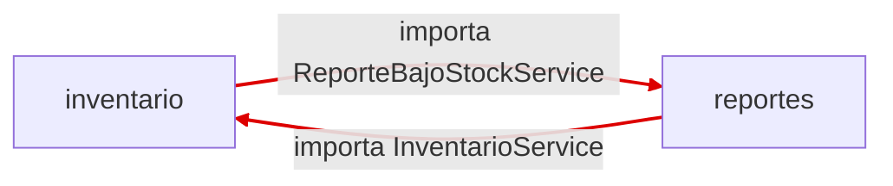

# herrera-post1-u11 — Refactorización Guiada por Pruebas

**Post-contenido Unidad 11 · Patrones de Diseño de Software · UDES (Ingeniería de Sistemas)**
Autor: Herrera · GitHub: `luisHerrera05`

Proyecto Maven / Spring Boot (`refactoring-u11`, Java 17) en la raíz del repositorio. Contiene las dos partes de la actividad:

1. **Parte 1** — pruebas de caracterización + eliminación de dos code smells (Long Method y Switch Statements duplicados).
2. **Parte 2** — módulo de reportes, ciclo de paquetes detectado con ArchUnit y resuelto con inversión de dependencias.

Ejecutar todo: `mvn test`

---

# Parte 1 — Red de seguridad y refactorización guiada por evidencia

## 1.1 Code smells de partida (commit "código original")

| Smell | Dónde | Evidencia |
|---|---|---|
| **Long Method** (Bloater) | `InventarioService.actualizarInventario()` | 44 líneas (de la firma a la llave de cierre), complejidad ciclomática ≈ 12 (conteo manual), **5 responsabilidades** mezcladas: validación, búsqueda, actualización de stock, cálculo de reorden y registro/alerta. 0 % de cobertura. |
| **Switch Statements duplicados** | `ClasificadorProducto.calcularRecargoEnvio()` y `EtiquetadoProducto.generarEtiqueta()` | 2 `switch` sobre `TipoProducto`, ambos con las mismas 4 ramas + `default` (8 `case` + 2 `default`). Agregar un tipo obliga a modificar 2 clases. |

## 1.2 Pruebas de caracterización (escritas ANTES de tocar el código)

Commit `test: agregar pruebas de caracterizacion antes de refactorizar`. Se instancian con `new`, sin contexto de Spring.

| Clase de prueba | # pruebas | Qué cubre |
|---|---|---|
| `InventarioServiceTest` | 10 | Entrada, salida válida, stock insuficiente, reorden con cantidad calculada (12), movimiento inválido, producto inexistente **y casos límite**: stock exactamente en el mínimo (no alerta: la condición es `<` estricta), vaciar el stock a 0 (reorden 15), cantidad 0, id nulo |
| `ClasificadorProductoTest` | 4 | Las 4 ramas del switch (0 %, 8 %, 3 %, fijo 2,50) |
| `EtiquetadoProductoTest` | 4 | Las 4 ramas del switch |
| **Total** | **18** | |

Resultado de `mvn test` sobre el código original (antes de refactorizar):

```
TODO: pegar aquí la salida real de `mvn test` en el commit de pruebas (Tests run: 18, Failures: 0)
```

## 1.3 Refactor del Long Method

**Técnica elegida (Fowler):** *Extract Method* (composición de métodos) aplicado a cada responsabilidad, más *Extract Class* para la política de reorden. Cada extracción se verificó con las pruebas.

| | Antes | Después |
|---|---|---|
| Líneas de `actualizarInventario()` | 44 | **10** (firma + 8 sentencias + llave) |
| Complejidad ciclomática (conteo manual) | ≈ 12 | ≈ 5 |
| Responsabilidades dentro del método | 5 | 0 (solo orquesta) |

Responsabilidades ahora separadas: `esEntradaValida`, `buscarProducto`, `calcularNuevoStock`, `registrarMovimiento`, `resolverReorden`, `alertarBajoStock` (métodos privados con nombre que revela intención) y `CalculadoraReorden` (clase colaboradora).

Resultado de `mvn test` tras el refactor: 18 pruebas, 0 fallos, **ninguna prueba modificada**.

```
TODO: pegar aquí la salida real de `mvn test` tras el commit de refactor del Long Method
```

### Decisión de diseño 1 — ¿método privado o clase `CalculadoraReorden`?

Elegí **clase colaboradora independiente (`CalculadoraReorden`)**. La regla de reorden (cuándo reordenar y cuántas unidades pedir, hoy "stock mínimo × 3 − stock actual") es una **política comercial** con razón de cambio propia: puede cambiar por decisión de compras (otro factor, reorden por proveedor, lote mínimo) sin que cambie nada de cómo se valida, busca o registra un movimiento. Dejarla como método privado la mantendría atada al ciclo de vida de `InventarioService` y la haría difícil de probar o sustituir de forma aislada. Además, el factor `3` deja de ser un número mágico y pasa a la constante `FACTOR_REPOSICION`. La clase se instancia internamente (no es un bean) porque las pruebas de caracterización hacen `new InventarioService()` y su firma pública no debía cambiar. El costo es una clase más; lo considero razonable porque la lógica es una política de negocio y no un simple detalle de implementación. Los demás pasos (validar, buscar, registrar, alertar) sí los dejé como métodos privados porque son simples, estables y no tienen razón de cambio independiente.

## 1.4 Refactor del Switch Statement duplicado

**Técnica elegida (Fowler):** *Replace Conditional with Polymorphism*, usando un **enum con métodos abstractos** (una implementación por constante). `ClasificadorProducto` y `EtiquetadoProducto` ahora solo delegan en `producto.getTipo()`.

| | Antes | Después |
|---|---|---|
| `switch` sobre `TipoProducto` | 2 (uno por clase) | **0** |
| `case` / `default` | 8 / 2 | 0 / 0 |
| Clases a modificar al agregar un tipo | 2 (`Clasificador` + `Etiquetado`) | **0** (solo se agrega una constante en el enum; el compilador exige implementar ambos métodos) |
| Firmas públicas | `calcularRecargoEnvio(Producto)`, `generarEtiqueta(Producto)` | Idénticas |

Comprobación: `grep -rEn "switch|case |else if" src/main` → 0 resultados.

```
TODO: pegar aquí la salida real de `mvn test` tras el commit del switch (Tests run: 18, Failures: 0)
```

### Decisión de diseño 2 — enum con métodos abstractos vs. interfaz de estrategia

Elegí el **enum con un método abstracto por comportamiento**. El conjunto de tipos (`LIBRO`, `ELECTRONICO`, `ROPA`, `ALIMENTO`) es **cerrado y estable** en este dominio, así que el enum da lo mejor de ambos mundos: polimorfismo real (cero condicionales) con una sola clase, y **seguridad en compilación**, porque si alguien agrega una constante y olvida un comportamiento, el código no compila (algo que el `default` del switch original ocultaba hasta tiempo de ejecución). Una interfaz de estrategia con una clase por tipo habría obligado a crear 8 clases (4 tipos × 2 comportamientos) o 4 con dos métodos, y a mantener un registro/mapa tipo→estrategia que puede quedar desincronizado con el enum. Esa jerarquía solo se justificaría si cada tipo necesitara **colaboradores inyectados por Spring** (por ejemplo, un servicio de impuestos distinto por tipo) o si los tipos se definieran dinámicamente; hoy no ocurre. Si ese escenario aparece, la migración es sencilla porque los clientes ya dependen de `producto.getTipo().…` y no de un switch.

## 1.5 Checkpoints de la Parte 1

- [x] Pruebas escritas y en verde antes de modificar `InventarioService`, `ClasificadorProducto`, `EtiquetadoProducto`.
- [x] `actualizarInventario()` ≤ 10 líneas, delegando en métodos con nombres que revelan intención.
- [x] Ningún `switch` / `if-else` sobre `TipoProducto` en todo `src/main`.
- [x] Las pruebas de caracterización no se modificaron después del commit de pruebas (`git diff <commit-pruebas> HEAD -- src/test/.../inventario` solo muestra archivos nuevos de la Parte 2, nunca cambios a los de la Parte 1).

---

# Parte 2 — Diagnóstico y resolución de acoplamiento entre paquetes

## 2.1 Módulo de reportes

Se agregó el paquete `reportes` (`ReporteBajoStockService`) y `InventarioService` lo notifica cuando detecta bajo stock, mediante un colaborador por setter (`@Autowired(required = false)`) para no tocar la firma que usan las pruebas de la Parte 1. Con el guard `!= null`, las 18 pruebas siguen en verde porque instancian el servicio directamente.

## 2.2 Diagnóstico: el ciclo, con evidencia

Todo compila y las 18 pruebas de negocio pasan, pero el diseño tiene un ciclo de paquetes:

```
InventarioService.java  : import ...reportes.ReporteBajoStockService   (inventario -> reportes)
ReporteBajoStockService : import ...inventario.InventarioService       (reportes -> inventario)
```

**Diagrama de paquetes ANTES (con ciclo):**




Las pruebas de negocio de la Parte 1 siguen en verde a pesar del ciclo: el problema es de **arquitectura**, no de comportamiento. Consecuencia práctica adicional: el ciclo de paquetes se traduce en un ciclo de beans de Spring (`InventarioService` ⇄ `ReporteBajoStockService`), que Spring Boot 2.6+ rechaza por defecto al arrancar la aplicación; las pruebas no lo detectan porque no levantan el contexto.

## 2.3 Resolución: inversión de dependencias

Se extrajo la interfaz `NotificadorBajoStock` **en el paquete `inventario`**. `InventarioService` ya no importa nada de `reportes` y solo conoce la abstracción; `ReporteBajoStockService` (en `reportes`) la implementa. Única dirección de dependencia: **`reportes → inventario`**.

**Diagrama de paquetes DESPUÉS (sin ciclo):**


```
reportes.ReporteBajoStockService  ──implements──▶  inventario.NotificadorBajoStock  ◀──usa──  inventario.InventarioService
(infraestructura / detalle)                        (abstracción, vive en el dominio)           (dominio)
```

Verificación de imports: `grep -rn "refactoringu11.reportes" src/main/java/.../inventario/` → sin resultados.


Como `ReporteBajoStockService` recibe el `Producto` y la cantidad en `notificar(...)`, ya no necesita el `InventarioService` en el constructor: se eliminó esa dependencia (y con ella el ciclo de beans de Spring y un campo que habría quedado sin uso).

### Decisión de diseño 3 — ¿por qué `NotificadorBajoStock` vive en `inventario` y no en `reportes`?

Porque **`inventario` es el paquete de mayor nivel de abstracción**: contiene el dominio (productos, stock, reglas de reorden) y es estable; `reportes` es infraestructura/presentación (cómo se comunica o se muestra un bajo stock) y es el detalle que más cambia (hoy un texto plano; mañana correo, Slack o PDF). La regla de la guía (sección 4.3) dice "los paquetes de infraestructura dependen de dominio; dominio nunca depende de infraestructura". La interfaz expresa una **necesidad del dominio** ("avisar que hay bajo stock") y por eso es el dominio quien la define y la posee; `reportes` solo la implementa. Si la interfaz viviera en `reportes`, `InventarioService` tendría que importarla de ahí y el ciclo (`inventario → reportes`) seguiría existiendo, solo que disfrazado de interfaz.

## 2.4 Confirmación: el comportamiento no cambió

Se ejecutó la suite completa sin modificar una sola línea de `InventarioServiceTest`, `ClasificadorProductoTest` ni `EtiquetadoProductoTest` (verificable con `git diff <commit-pruebas> HEAD -- <esos tres archivos>`: sin cambios).

| Suite | # pruebas |
|---|---|
| `InventarioServiceTest` (Parte 1, sin modificar) | 10 |
| `ClasificadorProductoTest` (Parte 1, sin modificar) | 4 |
| `EtiquetadoProductoTest` (Parte 1, sin modificar) | 4 |
| `InventarioNotificacionTest` (nueva, Parte 2) | 2 |
| `ReporteBajoStockServiceTest` (nueva, Parte 2) | 2 |
| `ArquitecturaPaquetesTest` (ArchUnit) | 1 |
| **Total `mvn test`** | **23** |


```

### Decisión de diseño 4 — `notificar(Producto, int)` por evento vs. por lote

Elegí la notificación **por evento individual**. Ventajas en este diseño: (1) `InventarioService` ya detecta el bajo stock **un movimiento a la vez** dentro de `actualizarInventario()`, así que el evento se emite exactamente donde se produce, sin que el dominio tenga que acumular estado ni decidir cuándo "cerrar" un lote; (2) la interfaz queda mínima y con una sola responsabilidad, fácil de implementar y de probar con un lambda (como en `InventarioNotificacionTest`); (3) la notificación es inmediata, útil para alertas en tiempo real. Preferiría **por lote** (`notificar(List<Producto>)`) en escenarios donde el costo por notificación sea alto o el destinatario no deba recibir ráfagas: p. ej. un correo diario consolidado a compras, una importación masiva de miles de movimientos, o un canal con límites de tasa. En ese caso la agregación sería responsabilidad del implementador (o de un decorador sobre `NotificadorBajoStock`) sin cambiar el contrato del dominio.

## 2.5 Checkpoints de la Parte 2

- [x] `InventarioService` no importa ninguna clase de `reportes`.
- [x] `ArquitecturaPaquetesTest` en rojo antes de la corrección (commit propio) y en verde en el estado final.
- [x] Pruebas de caracterización de la Parte 1 sin modificar y en verde.
- [x] Decisiones de diseño 1 a 4 documentadas con justificación.

